# Gloop Galaxy


$${\color{red}\text{ЗАМІНИТИ: у рядку з бейджем вище поставити свій логін GitHub замість GITHUB\_USER (і назву репозиторію, якщо вона інша), потім видалити цей рядок}}$$

Мультиплеєрна аркада в браузері: мультяшні кораблики, астероїди, бонуси, чорні діри й планети, які тягнуть до себе кулі, кораблі та каміння. До 16 пілотів у кімнаті, сервер на Node.js рахує гру 30 разів на секунду, клієнт передбачає власний рух і плавно показує чужий навіть при 100 мс затримки.

Проєкт курсу JavaScript, 8 лаб: від одного кораблика на canvas до гри в інтернеті. Автор: Федоренко Олексій, група Б-121-23-1-ПІ.

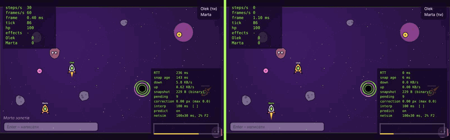

## Грати

$${\color{red}\text{ВСТАВИТИ: публічну адресу гри після деплою, наприклад https://gloop-galaxy.fly.dev (див. розділ «Деплой» у лабі 8)}}$$

$${\color{red}\text{ВСТАВИТИ: посилання на демо-відео (2-3 хв: лобі, гра вдвох, netgraph, перезапуск сервера)}}$$

- `W`/`↑` – газ, `A`/`D` або `←`/`→` – поворот, `Space` – постріл, `E` або лівий `Shift` – використати скіл, `Enter` – чат, `F2` – симуляція поганої мережі, `[`/`]` – затримка інтерполяції, `F3` – сховати netgraph.
- Арена 3200×1800 зі стінами, камера їде за кораблем, унизу мінікарта. Астероїди залітають з-за меж арени з різною швидкістю.
- Бонуси: щит, швидкий вогонь, самонавідні кулі. Одноразові скіли (лежать у слоті, поки не натиснеш `E`): самонавідна ракета, ядерна бомба (вибухає за 1,6 с, власника не чіпає), гравітаційне притягування на 5 с, варп-стрибок на 650 px вперед.
- Гравітація є у всього, крім кораблів: астероїди й бонуси тягнуть тим сильніше, чим вони більші. Чорна діра тягне кулі, астероїди й кораблі і з'їдає все, що перетне горизонт; корабель зі щитом вона викидає назад, забравши щит. Через 30 с діра колапсує. Планета теж тягне, але від неї відскакують, і удар знімає 15 hp.
- Гру можна встановити як застосунок (PWA): у Chrome – значок встановлення в адресному рядку, на Android – «Додати на головний екран».

## Запуск локально

```bash
npm install
cp server/.env.example server/.env
npm run dev
```

Відкрити http://localhost:5173 (Vite проксує `/api`, `/ws` і `/health` на сервер на 8080). Як у продакшні: `npm run build && npm start` → http://localhost:8080, або в контейнері: `docker compose up --build` → http://localhost:8080.

Перевірки: `npm run typecheck`, `npm run lint`, `npm test` (Vitest), `npm run coverage`, `npm run e2e` (Playwright).

## Архітектура

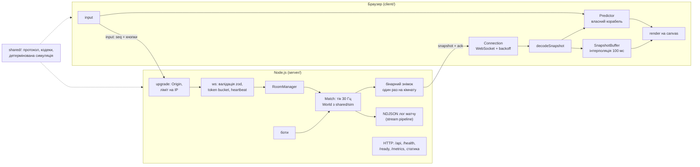

Один і той самий код симуляції (`shared/sim`) крутиться на сервері як джерело правди і на клієнті для передбачення власного корабля. Сервер нічого не довіряє клієнту, крім натиснутих кнопок; клієнт перемотує свої неперевірені вводи поверх кожного серверного стану.

## Цифри

| Що                                          | Результат                                                         | Де детально |
| ------------------------------------------- | ----------------------------------------------------------------- | ----------- |
| Знімок 8 кораблів + кулі, JSON → бінарний   | 3525 → 592 Б, 103 → 17 КБ/с на клієнта, кодування 32.9 → 5.9 мкс | лаба 5      |
| Поправка передбачення, детермінована симуляція | 0.005 px у середньому (з `Math.random()` у фізиці було 0.4 px) | лаба 5      |
| Кадр клієнта з 8 ботами, p50 / p99          | 0.7 / 2.1 → 0.3 / 1.2 мс після пулів і кешування                  | лаба 7      |
| Виділення пам'яті за 30 с гри               | 58.9 → 27.1 МБ, major GC 7 → 6 (причина нижче в лабі 7)           | лаба 7      |
| Ємність сервера (2 vCPU, кімнати по 8)      | 768 клієнтів на тіку 33.3 мс; на 1024 інтервал тіку 41 мс         | лаба 7      |
| Graceful shutdown з гравцями                | `shutdown` + 1001 усім і вихід за 9 мс роботи сервера             | лаба 8      |
| Флуд сміттям ~590 з'єднань/с поряд із кімнатою на 8 гравців | тік p99 сусідньої кімнати 1.3 → 0.7 мс, інтервал 33.3 мс | лаба 8 |
| Реальний RTT у двох гравців з інших мереж   | див. лабу 8                                                       | лаба 8      |

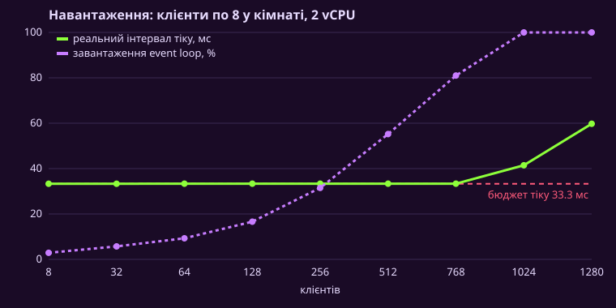

## Обмеження

- **Один процес, один потік.** Всі кімнати живуть в одному event loop, тому ємність – близько 768 гравців на 2 vCPU. Масштабувати горизонтально не можна без спільного стану: кімната прив'язана до процесу, а балансувальник не знає, де вона.
- **Немає lag compensation.** Влучання рахуються в «теперішньому» серверному стані, тому з 150+ мс RTT по рухомій цілі треба стріляти з упередженням.
- **Кожному гравцю йде весь світ.** Немає interest management: знімок містить усі сутності арени. На арені 3200×1800 з 9 гравцями знімок важить близько 1 КБ (30 КБ/с на гравця); з більшою кількістю об'єктів трафік ростиме лінійно.
- **Після перезапуску сервера матч втрачено.** Стан у пам'яті, тому гравці повертаються в лобі, а не в ту саму гру.
- **Немає сенсорного керування.** PWA встановлюється на телефон, але грати можна лише з клавіатурою.
- **Лог-флуд.** Кожне відхилене з'єднання пише рядок `warn`; під атакою на 600 з'єднань/с це 600 рядків/с. Метрика рахує правильно, але логи варто семплувати.
- **Major GC не нуль.** Знімки декодуються в об'єкти, частина з них переживає scavenge. Паузи 3 мс поза кадром, на грі не видно, але до нуля без structure-of-arrays не дійти.

## Що далі

- Кілька інстансів: sticky sessions за `roomId` на балансувальнику, або Redis з реєстром «кімната → інстанс».
- Lag compensation: сервер тримає історію позицій на ~200 мс і перевіряє постріл у момент, який бачив гравець.
- Interest management і дельта-знімки: слати тільки те, що поруч і що змінилось.
- Матчмейкінг і акаунти з таблицею рекордів.
- Сенсорне керування для телефона.

## Історія тегів

| Тег      | Що з'явилось |
| -------- | ------------ |
| `lab-01` | ігровий цикл з фіксованим кроком, корабель, HUD |
| `lab-02` | сутності на класах, кулі, астероїди, колізії, вибухи, бонуси |
| `lab-03` | асинхронне завантаження з прогресом і скасуванням, лобі, звук, чорні діри й планети |
| `lab-04` | Node.js сервер: кімнати, WebSocket, ліміти, логи матчів через streams |
| `lab-05` | сервер рахує гру, передбачення, звірка, інтерполяція, бінарний протокол |
| `lab-06` | весь код на TypeScript strict, zod на кордонах, CI |
| `lab-07` | 137 тестів, fast-check, Playwright, профілювання, пули, боти, навантажувальний тест |
| `lab-08`, `v1.0.0` | продакшн: метрики, health, graceful shutdown, Docker, деплой, PWA |
| `v1.1.0` | велика арена з камерою і мінікартою, гравітація всіх тіл, одноразові скіли, графіка і звуки Kenney |

Параметри в адресі для експериментів:

| Параметр        | Що робить                                                                                                                  |
| --------------- | -------------------------------------------------------------------------------------------------------------------------- |
| `?exp=block`    | раз на 60 кадрів `render` блокує потік на 100 мс                                                                           |
| `?exp=interval` | цикл на `setInterval(…, 16)` замість `requestAnimationFrame`                                                               |
| `?exp=variable` | змінний крок: `simulate(dt)` один раз за кадр                                                                              |
| `?probe`        | корабель летить сам за фіксованим сценарієм, у консоль раз на секунду пишеться статистика, а через 5 с симуляції – позиція |
| `?marks`        | вмикає `performance.mark/measure` навколо `simulate`, `render`, `decode`, `reconcile`; результат – `window.gloop.measures()`      |
| `?worker`       | бінарні знімки декодуються у Web Worker (експеримент з лаби 7, програв)                                                      |


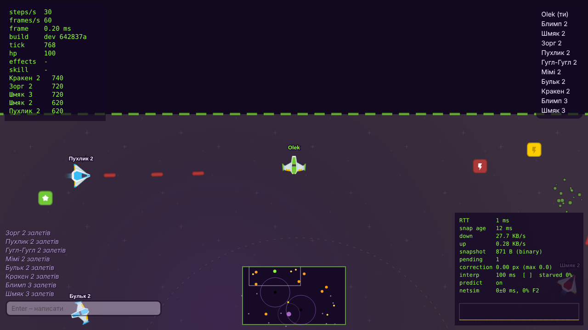

## Графіка і звуки

Спрайти кораблів, астероїдів, бонусів, куль, фони і звуки пострілу, влучання, бонуса, скіла і програшу – з паків [Kenney Space Shooter Redux](https://kenney.nl/assets/space-shooter-redux) і [Kenney Planets](https://kenney.nl/assets/planets), ліцензія CC0 (`client/public/assets/CREDITS.md`). Кадри зібрані в атласи 2–5 PNG, координати в `manifest.json`. Свої лишились тільки чорна діра (малюється на canvas) і звук вибуху.

# Журнал лаб

## Лаба 1. Event loop – це і є ігровий цикл

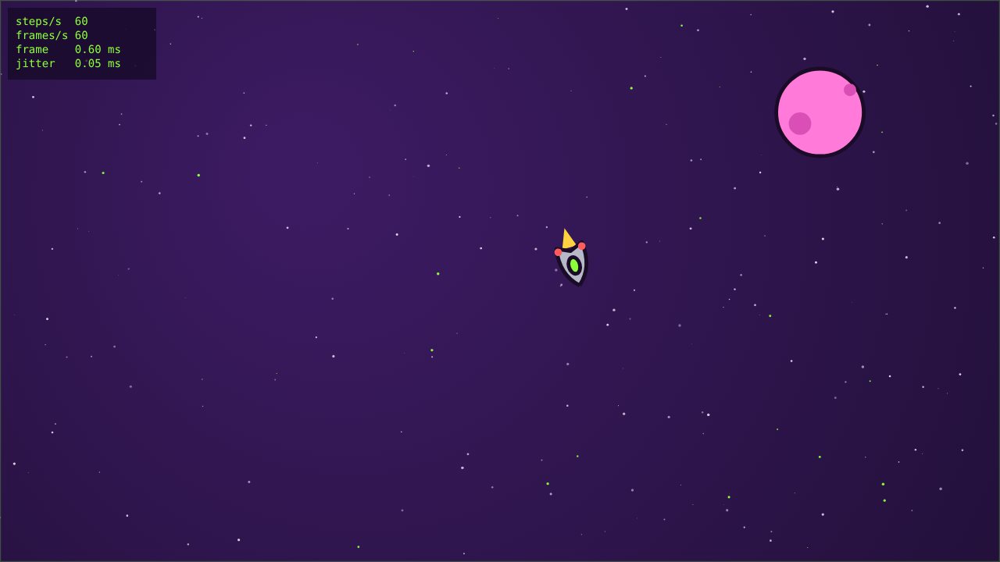

### Що зроблено

- Проєкт на Vite (vanilla JS), `"type": "module"`, `.nvmrc`, лінтер і форматер – Biome (`npm run lint`).
- `src/loop.js` – `createLoop({ step, simulate, render })` на `requestAnimationFrame` з акумулятором. Дельта кадру обрізається до 0,25 с, щоб після довгої паузи гра не намагалась «наздогнати» сотні кроків. Цикл рахує кроки симуляції за секунду, кадри за секунду, час кадру і розкид інтервалів між кадрами (jitter). Усе це видно на HUD.
- `src/input.js` – `createInput(target)`: стан клавіш живе в замиканні (`Set`), назовні тільки `isDown`, `justPressed` і `endStep`. `justPressed` спрацьовує один раз: множина натиснутих за крок очищується після кожного кроку симуляції, а не кадру, бо кадрів може бути більше або менше, ніж кроків.
- `src/sim/ship.js` – корабель це звичайний об'єкт `{ x, y, vx, vy, angle, thrust }`, а `integrate(ship, input, dt)` – чиста функція: повертає новий стан і нічого не знає про DOM чи canvas. `src/sim/arena.js` загортає корабель через краї арени.
- `src/render/` – canvas з урахуванням `devicePixelRatio` і зміною розміру вікна, арена 1600×900 масштабується під вікно. Між попереднім і поточним станом робиться інтерполяція з `alpha`. Кут інтерполюється найкоротшим шляхом, а позиція – з урахуванням загортання, інакше на краю арени корабель на один кадр «пролітав» через усе поле.

### Налаштування керування

Почав з `thrust = 200`, `drag = 0.3` – корабель розганявся повільно і потім довго ковзав, керувати було неприємно. Підняв тягу до 420 і опір до 0,9: тепер кораблик швидко відгукується, а без газу з максимальної швидкості зупиняється приблизно за 4 с. Поворот 3,6 рад/с – повний оберт трохи менше ніж за 2 с; при 5 рад/с було важко прицілитись. Максимальну швидкість обмежив 520 од/с, щоб арену можна було перетнути приблизно за 3 с.

### Експерименти

Числа знято в Chrome з параметром `?probe`, вікно 1280×720, дисплей 60 Гц.

**1. Блокування на 100 мс у `render` раз на 60 кадрів (`?exp=block`)**

|                                | Звичайний режим | З блокуванням |
| ------------------------------ | --------------- | ------------- |
| steps/s                        | 60              | 60            |
| frames/s                       | 60              | 55–56         |
| jitter                         | 0,06 мс         | 10,7–11,3 мс  |
| найдовший інтервал між кадрами | 16,8 мс         | 100 мс        |

Що бачить гравець: раз на секунду гра «замерзає» на 0,1 с, а потім корабель стрибає вперед. Кроків симуляції все одно 60 за секунду: після довгого кадру акумулятор накопичує ~6 кроків і цикл проганяє їх підряд. Тобто фізика не відстає, але плавність зникає.

Чому це неможливо обійти з JavaScript у тому самому потоці: event loop бере наступну задачу тільки коли стек викликів порожній. Поки `while` крутиться, стек не порожній, тож не можуть виконатися ні інші колбеки, ні мікрозадачі, ні rAF, ні рендер сторінки. Перервати функцію ззовні нічим, а таймер чи проміс лише поставить ще одну задачу в чергу, яка теж чекатиме. Варіанти тільки такі: зробити роботу коротшою, порізати її на шматки між кадрами або винести в Web Worker.

**2. `setInterval(frame, 16)` замість rAF (`?exp=interval`), 10 с + 5 с у фоновій вкладці**

|                    | rAF                         | setInterval(16)                  |
| ------------------ | --------------------------- | -------------------------------- |
| frames/s           | 60                          | 62–63                            |
| jitter             | 0,05–0,06 мс                | 0,1–1,1 мс                       |
| найдовший інтервал | 16,8 мс                     | 17–22 мс                         |
| у фоновій вкладці  | цикл зупинився, пауза 5,1 с | продовжував крутитися ~62 рази/с |

`setInterval` не прив'язаний до оновлення екрана: 1000 / 16 = 62,5 виклику за секунду при 60 Гц дисплеї, тому частина кадрів малюється даремно (екран їх не показує), а інтервали гуляють на кілька мілісекунд. У фоні таймер продовжує витрачати процесор на гру, яку ніхто не бачить. rAF у фоні просто не викликається. Коли вкладка повертається, перша дельта – 5 с, але завдяки обмеженню 0,25 с корабель не телепортується, а гра продовжується з того самого місця.

**3. Змінний крок (`?exp=variable`) і уповільнення CPU у 6 разів**

Сценарій `?probe` однаковий у всіх запусках. Позиція після 5 с часу симуляції:

| Режим           | CPU | кадри/с | x        | y       |
| --------------- | --- | ------- | -------- | ------- |
| змінний крок    | ×1  | 60      | 1430,235 | 495,811 |
| змінний крок    | ×6  | 33–42   | 1412,285 | 435,623 |
| фіксований крок | ×1  | 60      | 1429,148 | 445,487 |
| фіксований крок | ×6  | 35–39   | 1429,148 | 445,487 |

Зі змінним кроком траєкторія залежить від того, як швидко малюються кадри: при уповільненні корабель опинився на ~63 одиниці в іншому місці. Причина в тому, що інтегрування з великим `dt` дає іншу помилку, ніж з малим, і ще впливає, на який крок припадає перемикання повороту. З фіксованим кроком позиції збігаються до третього знаку: кадрів менше, але кроків симуляції рівно стільки ж (300) і з тим самим `dt`. Для мультиплеєра це критично: сервер і клієнти мають рахувати однаково.

$${\color{red}\text{СКРІНШОТ: відкрий гру в Chrome, F12, вкладка Performance, шестерня, CPU: 6x slowdown.}}$$
$${\color{red}\text{Відкрий адресу з параметром ?probe і exp=variable, зроби скрін вікна разом з консоллю, де видно рядок probe.}}$$
$${\color{red}\text{Збережи як docs/img/lab01-throttle.png і встав сюди: 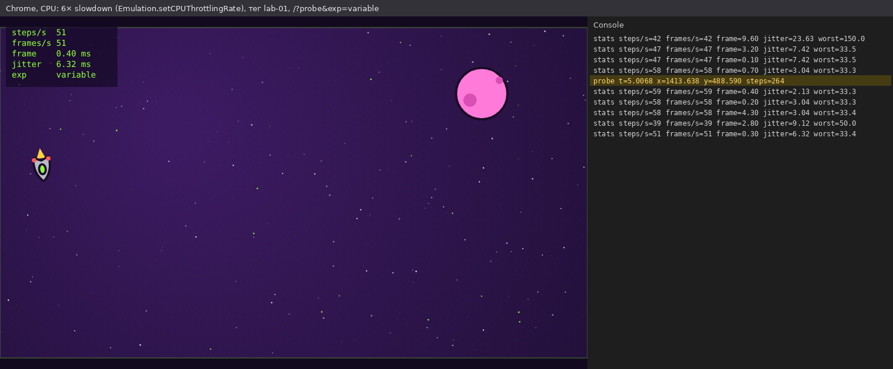}}$$

### Що я зрозумів

- `setTimeout(f, 0)` не виконується «зараз»: він ставить задачу в чергу, а мікрозадачі (`.then`, `await`) виконуються раніше, бо черга мікрозадач вичищається повністю після кожної задачі.
- rAF – це не задача і не мікрозадача, а крок рендеру: браузер викликає його перед малюванням кадру і не викликає, коли вкладку не видно.
- Симуляція і рендер мають різну частоту. Фізика – завжди 60 кроків/с, а малювання – скільки дозволяє екран, з інтерполяцією між двома станами.

## Лаба 2. Об'єкти, прототипи та this: модель сутностей

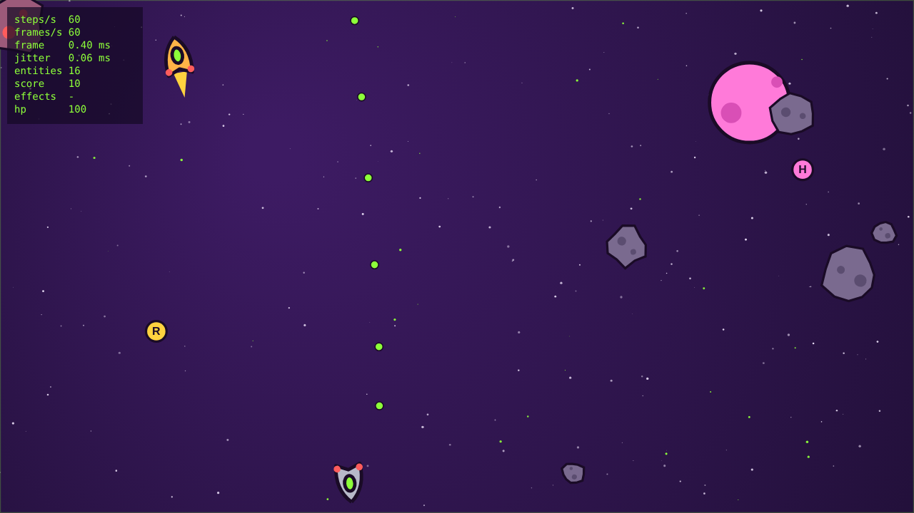

### Що зроблено

- `sim/vector.js` – `Vector2` з чистими методами (`add`, `sub`, `scale`, `length`, `normalize`, `rotate`, `dot`, `fromAngle`): жоден не змінює аргумент чи сам вектор. Окремих in-place версій поки не робив, бо вимірювань, що це треба, ще немає (до цього повернусь у лабі 7).
- `sim/entity.js` – базовий `Entity`: `id`, `pos`, `vel`, `angle`, `radius`, `alive`, `kind`, `update(dt)`. Лічильник id – приватне статичне поле `static #nextId`, а сам id – приватне `#id` з геттером, тож його не можна випадково перезаписати.
- `Ship extends Entity` – один рівень, глибше не йшов. Фізика лишилась у чистій функції `integrate` з лаби 1, клас лише перекладає стан у неї і назад. Перевірив: сценарій `?probe` дає ту саму позицію `x=1429.148 y=445.487`, що й до рефакторингу.
- `sim/world.js` – `World` поверх `Map<id, Entity>`: `spawn`, `despawn`, `get`, `[Symbol.iterator]`, генератор `*ofKind(kind)`. `despawn` лише ставить `alive = false`, а видалення робиться в `#sweep()` наприкінці кроку. Нові сутності, створені під час кроку (кулі, вибухи), складаються в чергу і потрапляють у `Map` після кроку, щоб не оновлюватись у тому ж кроці, в якому народились.
- `Bullet` (живе 1,1 с), `Asteroid` (дрейфує, обертається, відскакує від інших астероїдів), `Explosion` (частинки), `Pickup`.
- `sim/collision.js` – окрема система: отримує сутності і повертає пари `[a, b]`, що перетинаються (коло-коло, O(n²)). `World` приймає її як параметр `detect`, тож у лабі 7 її можна буде замінити на просторовий хеш. Що робити з парою, вирішує таблиця обробників у `sim/rules.js` за ключем `"bullet|ship"`, `"asteroid|ship"` тощо.
- У корабля приватне `#hp` і публічний `get hp()`. Змінити здоров'я можна лише через `damage()`. Знищений корабель лишає вибух і через 2 с з'являється у вільному місці (`world.findSafeSpot`). Рахунок: астероїд +10, корабель +100.
- Для тренування на арені літає помаранчевий «манекен» – такий самий `Ship` без гравця.
- Усі випадкові числа беруться з генератора з seed (`sim/random.js`), а не з `Math.random()`. Поки це просто зручно для відтворення багів, а в лабі 5 стане обов'язковим.

### Баг з this

Спочатку постріл я повісив на клавішу так:

```js
input.onPress("Space", ship.fire);
```

і отримав `TypeError: Cannot read properties of undefined (reading 'pos')`. Причина: передається сама функція `fire`, а не виклик `ship.fire()`. Обробник потім викликає її як звичайну функцію `handler()`, тобто за правилом default binding. Модулі і класи завжди в strict mode, тому `this` усередині – `undefined`.

Як можна виправити:

1. стрілка: `input.onPress("Space", () => ship.fire())` – `this` визначає виклик `ship.fire()`;
2. `ship.fire.bind(ship)` – створює копію функції з назавжди прив'язаним `this`;
3. поле-стрілка в класі: `fire = () => { … }` – у кожного екземпляра своя функція, `this` захоплюється лексично. Читається просто, але це окрема функція на кожен об'єкт і її немає в прототипі.

Я взяв стрілку (комміт `Fix this in fire handler`). А згодом постріл узагалі переніс у крок симуляції: `controls.fire` читається в `Ship.update`, там же враховується перезарядка. Так стрільба відбувається у фіксованому кроці, а не тоді, коли браузер доставив подію клавіатури, і сервер у лабі 5 зможе рахувати її так само.

### Композиція замість ієрархії

Дві фічі, які погано лягають у дерево класів:

- **homing** – самонаведення. Його мають і кулі (після підбору бонусу H), і частина астероїдів-«мисливців» (червоні, повільно повертають до найближчого корабля).
- **pickup** – бонуси S (щит), R (швидка стрільба), H (самонавідні кулі). Стоять на місці, мають колізію, але це не корабель і не снаряд.

Як виглядала б ієрархія:

```txt
Entity
├─ MovingEntity
│  ├─ Ship
│  ├─ Projectile
│  │  ├─ Bullet
│  │  └─ HomingBullet
│  └─ Asteroid
│     └─ HomingAsteroid
└─ StaticEntity
   └─ Pickup
```

Самонаведення довелося б написати двічі (`HomingBullet` і `HomingAsteroid` у різних гілках) або винести в спільного предка, якого отримали б і звичайні кулі. А якщо завтра треба самонавідну міну, яка стоїть на місці, вона не вписується ні в `MovingEntity`, ні в `StaticEntity`. Кожна нова комбінація – новий клас.

Що зробив я: у кожної сутності є масив `behaviors` – функції `(entity, world, dt)`, які `World.step` викликає після `update`. `homing({ targetKind, turnRate, range, ignoreId })` – фабрика, що повертає таку функцію і через замикання пам'ятає параметри. Самонавідна куля – звичайна `Bullet`, якій додали поведінку, «мисливець» – звичайний `Asteroid` з тією самою поведінкою, але меншим `turnRate`. Бонуси на кораблі – це `Map` ефектів з часом дії, які `Ship` перевіряє в `damage()` і `fire()`. `Pickup` – звичайна сутність з `kind: "pickup"`, а що робити при зіткненні, вирішує обробник `"pickup|ship"`.

Чому так: нова поведінка – це нова функція, а не новий клас, і її можна навісити на що завгодно. Поведінки – це дані, які легко серіалізувати (для лаби 5 знадобиться передавати стан по мережі). Мінус – менше перевірок від мови: ніхто не заборонить навісити homing на вибух. Для гри такого розміру це прийнятно.

## Лаба 3. Асинхронний JavaScript: завантаження, лобі, звук

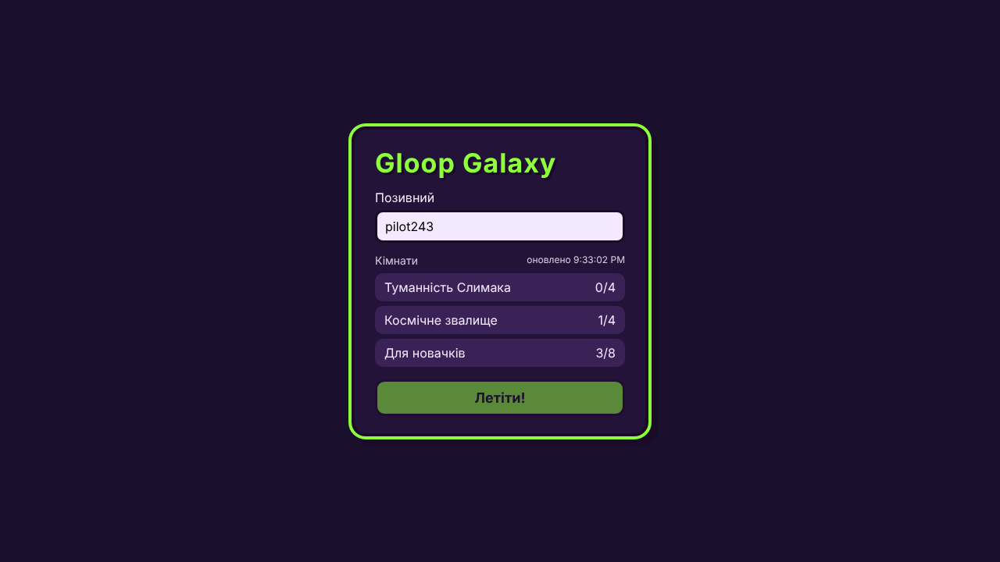

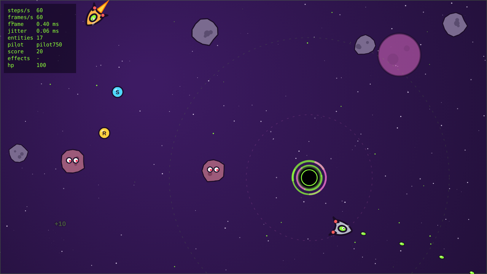

### Що зроблено

- `public/assets/manifest.json` – список спрайтшитів (з координатами кадрів), звуків і арен.
- `src/assets/loader.js`:
  - `fetchJson` перевіряє `response.ok` і кидає `HttpError`, а битий JSON перетворює на зрозумілу помилку з адресою файлу;
  - `loadImage` (fetch → blob → `createImageBitmap`), `loadAudio` (fetch → `arrayBuffer` → `decodeAudioData`) і `loadJson` приймають `AbortSignal`;
  - кожен запит додатково обмежений `AbortSignal.timeout(8000)`, сигнали об'єднуються через `AbortSignal.any`;
  - `loadAll` запускає все через `Promise.all`, а прогрес рахується обгорткою навколо кожного промісу.
- `src/assets/retry.js` – `withRetry` з exponential backoff і повним jitter (`random(0, min(cap, base · 2ⁿ))`). Повтор лише для мережевих помилок (`TypeError` з `fetch`) і 5xx. 4xx, битий JSON, таймаут і скасування не повторюються: від повтору результат не зміниться.
- Файли бувають обов'язкові (арени) і необов'язкові (спрайти, звуки). Якщо обов'язковий файл не завантажився, `loadAll` скасовує решту запитів через внутрішній `AbortController` і показує кнопку «Спробувати ще раз». Якщо не завантажився необов'язковий, гра стартує без нього: замість спрайтів малюються векторні фігури з лаб 1–2, замість звуку тиша.
- Завантажувальний екран на canvas: смуга прогресу і стан кожного файлу. Скасувати можна кнопкою або `Esc`.
- Спрайти з трьох листів (`ships.png`, `asteroids.png`, `items.png`) малюються через `drawImage` з прямокутником кадру.
- `src/audio.js` – свій `AudioContext`. Звуки декодуються ще під час завантаження, а `resume()` викликається після кліку «Летіти!» у лобі, бо браузер не дає грати звук без жесту користувача.
- `World` тепер `extends EventTarget` і розсилає `CustomEvent`: `fired`, `hit`, `exploded`, `scored`, `pickup`, `swallowed`, `collapsed`. `sim/` не імпортує ні `audio.js`, ні `hud.js`: звук і спливаючі «+10» підписуються на події світу. `EventTarget` і `CustomEvent` є і в браузері, і в Node 22, тож симуляцію можна буде запускати на сервері.
- Лобі: `class Lobby extends EventTarget` (`refresh`, `start`, `stop`, `join`; події `loading`, `rooms`, `error`, `join`) і окремий модуль `lobby/view.js`, який малює DOM і лише слухає події. Поки лобі відкрите, список кімнат оновлюється раз на 3 с. Кожен запит має `AbortSignal.timeout(4000)`. Новий запит скасовує попередній, а `join` зупиняє таймер і скасовує запит, що ще йде, тож після входу в гру «осиротілих» запитів немає. Список поки віддається статичним `public/api/rooms.json`, у лабі 4 його замінить сервер.
- Кімната визначає арену: «Туманність Слимака» або «Космічне звалище». В арені свої кольори, кількість астероїдів і бонусів, seed і гравітаційні об'єкти.

### Додатково: чорні діри і гравітаційні планети

Цього немає в завданні, захотілося зробити гру цікавішою.

- `sim/well.js` – `GravityWell`, сутність `kind: "well"` двох типів:
  - **чорна діра** – радіус горизонту 26, тяжіння діє в радіусі 460. Повільно дрейфує, а через 30 с «схлопується» і за 4 с з'являється в іншому місці. Останні 3 с обідок блимає червоним;
  - **планета** – тверда, тяжіння слабше (радіус 340). Об неї корабель відскакує і втрачає 15 hp.
- `sim/gravity.js` – окрема система: прискорення `strength / d²` (з обмеженням на дуже малій відстані, щоб не було нескінченності) діє на кораблі, кулі й астероїди. `World` тепер приймає список систем, які викликаються щокроку перед колізіями.
- Що відбувається біля чорної діри: кулі закручуються (можна стріляти по дузі), астероїди падають і з'являються знову через 2 с, корабель гине. Якщо на кораблі є щит, його викидає назовні, а щит зникає.
- На повному газу з відстані 150 від центру ще можна вирватись, ближче вже ні.
- Усе рахується з фіксованим кроком і через `world.rng`, тож у лабі 5 сервер і клієнт отримають однакову гравітацію.

### Послідовно чи паралельно

9 файлів, `?slow` (кожен відповідає із затримкою від 300 до 780 мс), по 3 запуски:

| Режим | Час, мс |
|---|---|
| `Promise.all` | 1236 / 1243 / 1251 |
| послідовні `await` (`?sequential`) | 4946 / 4953 / 4956 |

Послідовно час – це сума всіх затримок (≈ 4,9 с). Паралельно мало б бути близько найдовшої затримки (0,78 с), а вийшло 1,24 с. Причина в тому, що dev-сервер працює по HTTP/1.1, а браузер тримає не більше 6 з'єднань на хост: перші 6 файлів ідуть разом, решта чекають вільного з'єднання. Але це все одно в 4 рази швидше.

### Галерея збоїв

| Збій | Як відтворити | Що відбувається |
|---|---|---|
| 404 спрайта | `?fail=404` | `HttpError 404`, без повторів. Екран «Частина файлів не завантажилась» і кнопка «Грати без них», бонуси й кулі малюються векторно |
| таймаут мережі | `?fail=timeout` (файл відповідає через 12 с) | через 8 с `TimeoutError` (signal timed out), гра стартує без спрайтів астероїдів |
| скасування посеред завантаження | `?fail=abort` або `Esc` | незавершені запити скасовуються, екран «Завантаження скасовано» і кнопка «Спробувати ще раз» |
| битий JSON | `?fail=json` | `Bad JSON in /assets/arenas/junkyard.json`, решта запитів скасовуються, кнопка «Спробувати ще раз» |
| 503 двічі поспіль | `?fail=flaky` | два повтори з паузами 95 і 346 мс, з третьої спроби файл завантажився |

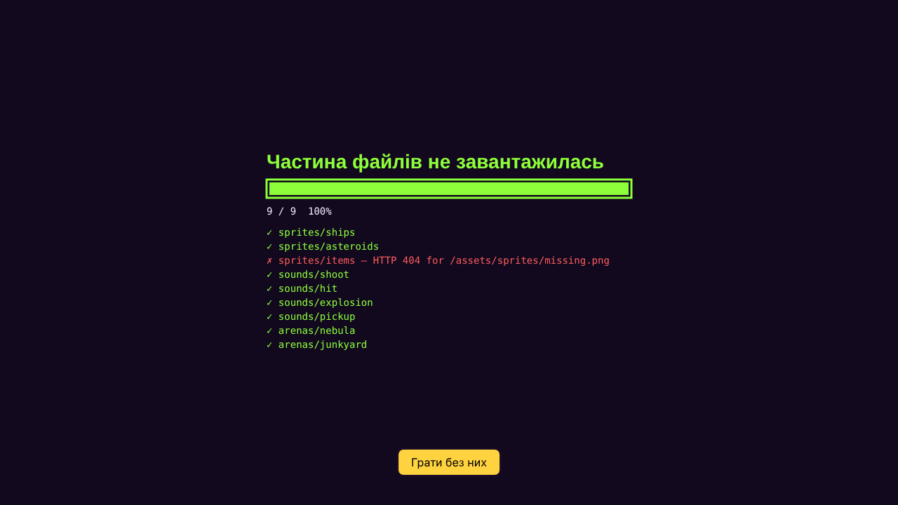
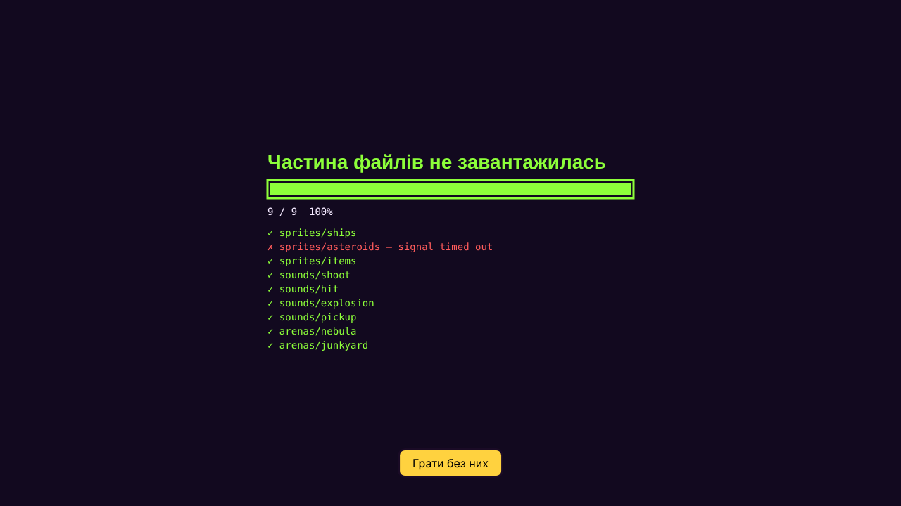
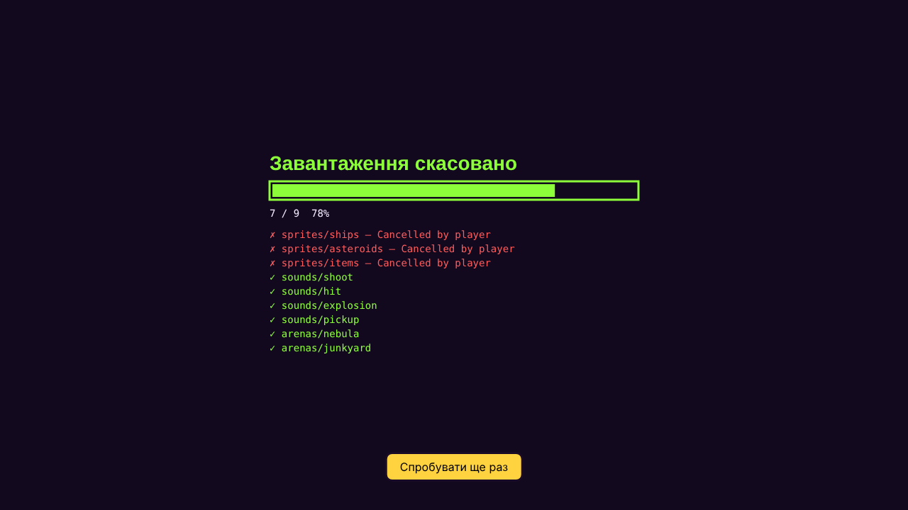
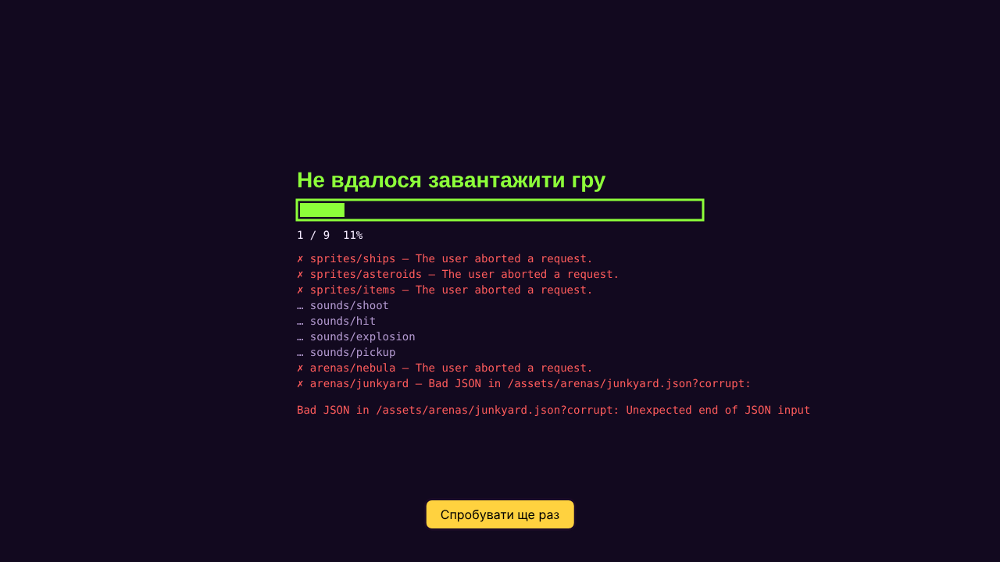

Лог для `?fail=flaky`:

```txt
retry /assets/sounds/shoot.wav?flaky=…: attempt 1 failed (HTTP 503 …), next in 95 ms
retry /assets/sounds/shoot.wav?flaky=…: attempt 2 failed (HTTP 503 …), next in 346 ms
assets concurrent 489 ms
```

Під час першого запуску з'ясувалось, що Vite на будь-який неіснуючий шлях віддає `index.html` зі статусом 200. Тобто «404» насправді приходив як HTML, а `createImageBitmap` падав з помилкою декодування, яку я ще й повторював тричі. Виправив двома змінами: `appType: "mpa"` у `vite.config.js`, щоб сервер чесно відповідав 404, і повтори лише для мережевих помилок і 5xx.

### Головоломки з порядком виконання

Усі п'ять перевірив у Node 22 (третю – у Chrome).

**1. await**

```js
const log = [];
async function load() {
  log.push("A");
  await null;
  log.push("B");
}
setTimeout(() => log.push("C"), 0);
load();
Promise.resolve().then(() => log.push("D"));
log.push("E");
```

Вивід: `A E B D C`. `load()` до першого `await` виконується синхронно (A), продовження після `await` стає мікрозадачею раніше за `.then` з D, а таймер – це задача, тож він останній.

**2. setTimeout всередині .then**

```js
Promise.resolve().then(() => {
  log.push("1");
  setTimeout(() => log.push("2"), 0);
  Promise.resolve().then(() => log.push("3"));
});
setTimeout(() => {
  log.push("4");
  Promise.resolve().then(() => log.push("5"));
}, 0);
log.push("6");
```

Вивід: `6 1 3 4 5 2`. Мікрозадачі вичищаються до кінця (1, потім 3, бо його додали під час того самого вичищення). Таймер з «4» було поставлено раніше за таймер з «2», бо «2» з'явився лише в мікрозадачі. Після задачі «4» знову вичищаються мікрозадачі (5), і лише потім настає черга «2».

**3. requestAnimationFrame**

```js
requestAnimationFrame(() => {
  log.push("raf1");
  setTimeout(() => log.push("timeout"), 0);
  Promise.resolve().then(() => log.push("micro"));
  requestAnimationFrame(() => log.push("raf2"));
});
```

Вивід (Chrome, 3 запуски однаково): `raf1 micro timeout raf2`. Мікрозадача виконується одразу після колбека rAF. `setTimeout(0)` – звичайна задача, яка встигає до наступного кадру, а `raf2` чекає наступного кадру (~16,7 мс).

**4. await на async-функції**

```js
async function a() { log.push("a1"); await b(); log.push("a2"); }
async function b() { log.push("b1"); }
a().then(() => log.push("then"));
queueMicrotask(() => log.push("micro"));
log.push("sync");
```

Вивід: `a1 b1 sync a2 micro then`. `b()` виконується синхронно і повертає вже виконаний проміс. `await` на рідному промісі ставить продовження в чергу раніше за `queueMicrotask`. `then` чекає, поки виконається вся `a()`, тобто ще одну мікрозадачу.

**5. Виконавець промісу і ланцюжки**

```js
const p = new Promise((resolve) => {
  log.push("executor");
  resolve("x");
  log.push("after resolve");
});
p.then(() => log.push("then1")).then(() => log.push("then2"));
Promise.resolve().then(() => log.push("other1")).then(() => log.push("other2"));
log.push("end");
```

Вивід: `executor after resolve end then1 other1 then2 other2`. Виконавець запускається синхронно, і `resolve` його не перериває. Два ланцюжки чергуються: кожен наступний `.then` потрапляє в чергу лише після виконання попереднього.

## Лаба 4. Node.js: EventEmitter, streams, WebSocket-сервер

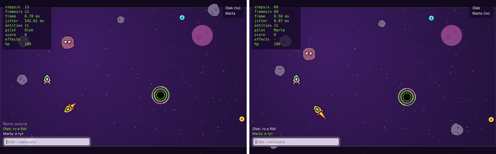

### Структура

Репозиторій тепер складається з npm workspaces:

```txt
client/          гра з лаб 1–3 (Vite)
server/
  src/
    index.js     http-сервер, WebSocketServer, сигнали завершення
    config.js    налаштування з оточення з перевіркою
    http.js      API, статика, захист від ../
    rooms.js     Room extends EventEmitter, RoomManager
    protocol.js  типи повідомлень, версія, перевірка
    ws.js        життєвий цикл сокета, heartbeat, обмеження
    ratelimit.js token bucket
    logger.js    логи рядками JSON
    log/
      matchlog.js  Transform: події -> NDJSON, pipeline у файл
      replay.js    читання логу як async-генератора, список повторів
  scripts/
    make-big-log.js  синтетичний лог потрібного розміру
    bad-frame.js     надсилає зламаний WebSocket-кадр
  test/          node:test
```

### HTTP

- `node:http` без фреймворків. Маршрути:
  - `GET /health` – статус, uptime, кімнати і гравці;
  - `GET /api/rooms` – список кімнат;
  - `POST /api/rooms` – нова кімната: тіло до 4 КБ, лише `application/json`, назва 1–32 символи, арена `nebula` або `junkyard`. Відповідь 201, або 400/413/415 з поясненням;
  - `GET /api/replays` і `GET /api/replays/:id` – список логів і віддача логу потоком.
- Статика з `client/dist`: правильні MIME-типи, а шлях декодується і перевіряється, щоб `..`, `%2e%2e%2f` чи нульовий байт не вивели за межі папки (`resolveStatic`, є тести).
- `config.js` читає `PORT`, `HOST`, `LOG_DIR`, `STATIC_DIR`, `MAX_ROOMS`, `MAX_PLAYERS_PER_ROOM`, `MESSAGES_PER_SECOND`, `JOIN_TIMEOUT_MS`, `HEARTBEAT_MS`. Якщо значення некоректні, сервер не стартує і виводить усі помилки разом. У розробці значення беруться з `.env` через `--env-file-if-exists`.
- На `SIGINT`/`SIGTERM` сервер перестає приймати з'єднання, надсилає клієнтам `shutdown`, закриває сокети з кодом 1001, дописує логи матчів і виходить з кодом 0. Перевірив з підключеним гравцем: вихід за 12 мс, у логі матчу останній рядок `{"type":"end"}`. Якщо щось зависне, за 10 с процес завершується примусово.

### Кімнати і WebSocket

- `Room extends EventEmitter`: `players` – це `Map`. Методи `join`, `leave`, `chat` генерують однойменні події, а для логу ще й загальну подію `event`. Коли кімната порожніє, вона генерує `empty`.
- `RoomManager` створює кімнати, видаляє порожні (дві стандартні кімнати постійні). Кімнату, створену через API, в яку ніхто не зайшов, видаляє через хвилину.
- Протокол v0 – JSON `{ v: 0, type, ... }`:
  - від клієнта: `join { room, name }`, `chat { text }`, `leave`;
  - від сервера: `welcome`, `roster`, `chat`, `error`, `shutdown`.
- Кожне повідомлення перевіряється: розмір до 2 КБ, коректний JSON, об'єкт, версія 0, відомий тип (через `Object.hasOwn`, щоб `"constructor"` не пройшов як тип), поля потрібної форми. Якщо щось не так, клієнт отримує `error` і сокет закривається з кодом:

| Код | Причина |
|---|---|
| 4000 | зламане або невідоме повідомлення |
| 4001 | не надіслав `join` за 5 с |
| 4002 | забагато повідомлень |
| 4003 | кімната заповнена |
| 4004 | немає такої кімнати |
| 4006 | клієнт не встигає читати |
| 1009 | кадр більший за `maxPayload` (4 КБ), закриває сама бібліотека `ws` |

- Heartbeat: `ping` раз на 15 с, після двох пропущених `pong` – `terminate()`.
- На кожному сокеті є слухач `"error"`.
- Клієнт `client/src/net/connection.js` – клас `Connection extends EventTarget`:
  - розсилає повідомлення сервера як події з назвою `type`;
  - поки з'єднання немає, складає вихідні повідомлення в чергу (до 100);
  - при розриві перепідключається з паузою 0,5 → 1 → 2 … до 10 с з випадковим розкидом. Після перепідключення гра сама надсилає `join` знову;
  - на кодах 4000/4003/4004 не перепідключається, бо повтор нічого не змінить.
- Лобі тепер бере кімнати з `/api/rooms` і може створити нову. У грі `Enter` відкриває чат, справа вгорі – список гравців кімнати.

### Обмеження

- token bucket на кожне з'єднання: 20 повідомлень/с, запас 40. Тест: клієнт, що слав по 10 повідомлень кожні 10 мс, отримав `4002 too many messages` через 47 мс (40 повідомлень);
- `maxPayload: 4096`: кадр на 5 КБ закривається з кодом 1009;
- не більше 50 кімнат на сервер і 8 гравців у кімнаті (налаштовується);
- повільний клієнт: якщо в сокеті висить понад 64 КБ невідправлених даних (`bufferedAmount`), чат йому не надсилається, а понад 1 МБ – сокет закривається з кодом 4006. Важливі повідомлення (`welcome`, `roster`, `error`) надсилаються, поки не досягнуто 1 МБ.

### Логи матчів

Коли в кімнату заходить перший гравець, починається лог `logs/<кімната>-<час>.ndjson`:

```js
const events = Readable.from(on(room, "event", { close: ["closed"] })).map(([event]) => event);
pipeline(events, toNdjson(), createWriteStream(file, { flags: "a" }));
```

`toNdjson()` – `Transform` з `writableObjectMode`, який перетворює подію на рядок JSON. Коли кімната порожніє, `endMatch()` генерує `closed`, ітератор `on()` завершується, і `pipeline` закриває файл. `readEvents(file)` у `replay.js` – async-генератор: `createReadStream` + `readline`, повертає розібрані події по одній.

Приклад логу:

```txt
{"t":1794512600716,"room":"room-1","type":"join","player":"c678ad50","name":"Olek"}
{"t":1794512600717,"room":"room-1","type":"join","player":"dc549f77","name":"Bob"}
{"t":1794512600812,"room":"room-1","type":"chat","player":"c678ad50","text":"привіт"}
{"t":1794512600917,"room":"room-1","type":"leave","player":"dc549f77","reason":"closed 4000"}
```

### Backpressure: пам'ять при віддачі великого логу

`node server/scripts/make-big-log.js 200` згенерував лог на 200 МБ. Я завантажував його через `curl --limit-rate 10M` (повільний клієнт, ~20 с) і раз на 250 мс записував `rss` процесу сервера. Для порівняння зробив другий варіант того самого ендпоінта (`?buffered`): `readFile` усього файлу і `res.end(buffer)`.

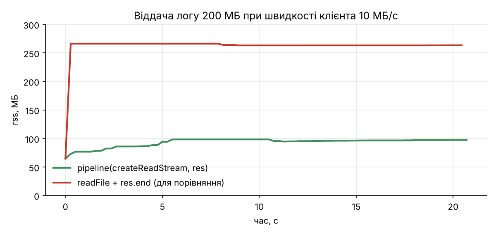

| Варіант | rss на старті | максимум |
|---|---|---|
| `pipeline(createReadStream(file), res)` | 65 МБ | 98 МБ |
| `readFile` + `res.end` | 65 МБ | 266 МБ |

З `pipeline` пам'ять трохи росте в перші секунди (буфери, JIT) і далі лишається рівною, хоча клієнт читає в 10+ разів повільніше, ніж диск віддає. Коли `res.write()` повертає `false`, `pipeline` ставить `createReadStream` на паузу і продовжує після `drain`. З `readFile` увесь файл одразу лежить у пам'яті, і так на кожне одночасне завантаження: десять повільних клієнтів – 2 ГБ.

$${\color{red}\text{СКРІНШОТ (за бажанням): Chrome DevTools, Network, Throttling: Slow 4G, відкрий /api/replays/synthetic-big.}}$$
$${\color{red}\text{Скрін вкладки Network з повільним завантаженням, файл docs/img/lab04-throttle.png.}}$$

### Цикл подій і чому один обробник може зупинити все

Цикл подій Node (libuv) проходить фази: **timers** (`setTimeout`/`setInterval`) → **pending callbacks** → **poll** (нові з'єднання, дані з сокетів і файлів) → **check** (`setImmediate`) → **close callbacks**. Між колбеками вичищаються `process.nextTick` і мікрозадачі промісів. JavaScript виконується в одному потоці, тож поки один колбек працює, решта фаз чекають.

Експеримент: у режимі `DEMO_ENDPOINTS=1` є `GET /api/slow?ms=300`, який 300 мс крутить синхронний цикл. Клієнт у кімнаті надсилав чат кожні 100 мс і міряв, за скільки повідомлення повертається. Інший клієнт тим часом викликав `/api/slow` кожні ~500 мс.

| | p50 | p95 | максимум |
|---|---|---|---|
| без навантаження | 0,7 мс | 1,3 мс | 3,0 мс |
| з `/api/slow` | 12,2 мс | 215,4 мс | 216,8 мс |

Поки крутиться цикл, сервер не читає жоден сокет, не відповідає на `ping` і не відправляє чат нікому, у тому числі гравцям інших кімнат. Для гри, яка в лабі 5 рахуватиме 30 кроків на секунду (33 мс на крок), 300 мс блокування – це дев'ять пропущених кроків. Висновок: важкі обчислення не можна робити в обробнику – їх треба ділити на шматки, виносити у `worker_threads` або в окремий процес.

**Де проявився backpressure:** у віддачі логу (графік вище), у записі логу матчу (`pipeline` сам чекає, поки `createWriteStream` встигне записати) і в WebSocket: `bufferedAmount` – це те саме, що черга в `res.write()`, тому повільним клієнтам перестаю надсилати чат.

**Чому `"error"` без слухача валить увесь сервер.** У `EventEmitter` подія `"error"` особлива: якщо в неї немає слухача, `emit("error")` кидає виняток. Він вилітає з колбека потоку, його ніхто не ловить, і процес завершується разом з усіма кімнатами. Перевірив: прибрав `ws.on("error")` і надіслав скриптом `scripts/bad-frame.js` кадр з увімкненим біт RSV1:

```txt
node:events:497
      throw er; // Unhandled 'error' event
      ^

RangeError: Invalid WebSocket frame: RSV1 must be clear
    at Receiver.getInfo (node_modules/ws/lib/receiver.js:232:26)
    ...
Emitted 'error' event on WebSocket instance at:
    at Receiver.receiverOnError (node_modules/ws/lib/websocket.js:1251:15)
  code: 'WS_ERR_UNEXPECTED_RSV_1',
  [Symbol(status-code)]: 1002
}

Node.js v22.23.4
```

Один зламаний клієнт поклав сервер. Зі слухачем той самий кадр дає лише рядок у лозі, а сокет закривається:

```txt
{"level":"warn","message":"socket error","error":"Invalid WebSocket frame: RSV1 must be clear","code":"WS_ERR_UNEXPECTED_RSV_1"}
```

З необробленим відхиленням промісу так само: з Node 15 `unhandledRejection` за замовчуванням завершує процес. Тому всі асинхронні обробники HTTP загорнуті в `try/catch` і відповідають 500, а проміси логів матчів мають `.catch`.

### Тести

`npm test` (`node --test`): перевірка протоколу (зокрема `__proto__`/`constructor`), token bucket з підставним годинником, лог матчу від подій до файлу й назад, захист статики від `..`.

## Лаба 5. Сервер рахує гру: передбачення, звірка, бінарний протокол

GIF двох вікон – на початку README.

### Що зроблено

**Спільний пакет `shared/`.** Тепер у репозиторії три workspaces: `shared`, `client`, `server`. У `shared/` переїхала вся симуляція (`sim/`), а ще `protocol.js` (типи повідомлень, кнопки, прапорці), `codec/binary.js` і `codec/json.js`, `arenas.js` (налаштування арен для сервера). Тест `shared/test/sim.test.js` запускає симуляцію в Node і перевіряє, що там немає `window`/`document`.

**Детермінізм.**
- Ніде в симуляції немає `Math.random()` і `Date.now()`, лише `world.rng` з seed арени.
- Ідентифікатори сутностей видає `World`, а не статичний лічильник класу: на сервері кілька кімнат, і id має вміщатися в Uint16.
- Після кожного кроку сервер округлює стан кораблів до тієї точності, з якою їх передає (Float32 і 1/10000 рад). Клієнт округлює своє передбачення так само.
- Тест: однакові введення дають однаковий хеш світу.

**Сервер.** `server/src/match.js` – `Match` на кожну кімнату. 30 кроків на секунду, наступний крок планується на абсолютний час (`next += 1000/30; setTimeout(tick, next - now)`), а не через `setInterval`. Порівняв на 150 кроках:

| Таймер | середній інтервал | розкид | дрейф за 5 с |
|---|---|---|---|
| `setInterval(fn, 33)` | 33,25 мс | 0,36 мс | −12,5 мс |
| `setTimeout` на абсолютний час | 33,33 мс | 0,43 мс | −0,3 мс |

`setInterval(33)` за 5 с поспішає на 12 мс, бо 33 ≠ 33,33, і за хвилину набігає вже 150 мс. `GET /api/stats` показує для кожного матчу тривалість кроку (p50/p99/max) і розкид інтервалів. З 4 гравцями: крок 0,48 мс (p50) / 2,06 мс (p99), розкид інтервалу 0,92 мс.

Клієнт надсилає не координати, а кнопки з номером `seq`. Сервер для кожного введення робить один крок корабля (`ship.steer`). Кнопки перевіряються (лише 4 біти, `seq` – uint32), введення обмежені окремим token bucket (60/с). Тобто корабель рухається рівно стільки кроків, скільки введень надіслав гравець, і не залежить від того, коли саме вони дійшли. Тому передбачення на клієнті збігається з сервером навіть при розкиді затримки. Кожен знімок містить `tick` і `ack` (останній оброблений `seq` цього гравця). Бінарний знімок кодується один раз на тік, а `ack` дописується в копію для кожного гравця (`setAck`).

У кімнаті завжди літає «манекен» – корабель-бот, щоб було в кого стріляти поодинці.

**Імітація поганої мережі.** У `ws.js` для кожного з'єднання є `netsim`: затримка + випадковий розкид для вхідних і вихідних повідомлень і відсоток втрат для знімків і введень. Задається параметрами адреси (`?lag=100&jitter=30&drop=0.02`) або на льоту клавішею `F2` (повідомлення `netsim`). Працює лише з `DEMO_ENDPOINTS=1`, у продакшні сервер таке повідомлення відхиляє.

**Netgraph** (правий нижній кут): RTT (ping/pong раз на секунду), вік знімка, KB/s вниз і вгору, розмір знімка, кількість непідтверджених введень, величина поправки (останнє значення, максимум за секунду і графік за 4 с), затримка інтерполяції і частка кадрів, коли для інтерполяції забракло знімків.

**Передбачення і звірка** (`client/src/online/prediction.js`):
- кожен крок клієнт застосовує своє введення до свого корабля тією самою `shipPhysics`, що й сервер, і кладе введення в буфер;
- коли приходить знімок, клієнт бере стан корабля з сервера, викидає введення з `seq ≤ ack` і заново програє решту;
- різниця між старим і новим передбаченням – це поправка. Вона не застосовується стрибком: зсув відображення згасає приблизно за 100 мс.

Гравітацію клієнт теж передбачає: позиції чорних дір беруться зі знімка і зсуваються вперед за їхньою швидкістю.

**Інтерполяція** (`client/src/online/interpolation.js`):
- знімки складаються в буфер, а для кожного кадру рахується «серверний час». Зсув між місцевим і серверним часом береться як мінімум за останні 90 знімків, тобто по найменш затриманому пакету, тож розкид не смикає картинку;
- чужі сутності малюються в момент `серверний час − delay` між двома знімками навколо нього;
- сутність, якої не було в старшому знімку, з'являється в другій половині проміжку, а та, якої немає в новішому, просто зникає;
- свої кулі клієнт створює одразу при пострілі (поле `shot` = `seq` введення). Серверні копії своїх куль не малюються, а локальна куля зникає, коли сервер її більше не надсилає.

**Бінарний протокол** – специфікація в [docs/protocol.md](docs/protocol.md). `DataView`, little-endian, байт версії, кут як Int16 в 1/10000 рад. На клієнті `binaryType = "arraybuffer"`. JSON лишився за параметром `?codec=json`. Тести в `shared/test/codec.test.js`: `decode(encode(x))` дорівнює `x`, `ack` можна дописати в готовий буфер, кут втрачає не більше 0,00005 рад, обрізаний чи зіпсований буфер дає `CodecError`, а не сміття.

### Вимірювання: JSON проти бінарного формату

4 клієнти в одній кімнаті (плюс манекен), 30 знімків/с, клієнти тиснуть газ і стріляють, вимірювання за 10 с. Час кодування і декодування – `node server/scripts/bench-codec.js` (25 сутностей, 20 000 повторів).

| Кодек | Байтів на знімок | KB/s на клієнта (вниз) | KB/s на клієнта (вгору) | encode+decode, мкс |
|---|---|---|---|---|
| JSON | 3525 | 103,3 | 3,09 | 32,9 |
| Бінарний (`DataView`) | 592 | 17,4 | 0,53 | 5,9 |

Бінарний формат у 6 разів менший і в 5,5 раза швидший. Більшість різниці в JSON дають числа з плаваючою крапкою (`812.2500610351562` – це 17 символів замість 4 байтів) і повторювані назви полів.

### Netcode: що вирішено і як

**Затримка.** Без передбачення (`?predict=0`) при 100 мс в один бік корабель реагує на клавішу лише через RTT ≈ 200–230 мс плюс до одного тіку. Грати неприємно: натискаєш поворот, а корабель ще чверть секунди летить прямо і лише потім довертає. З передбаченням свій корабель реагує в тому ж кадрі, а затримку видно лише на чужих кораблях і на тому, коли зараховується влучання.

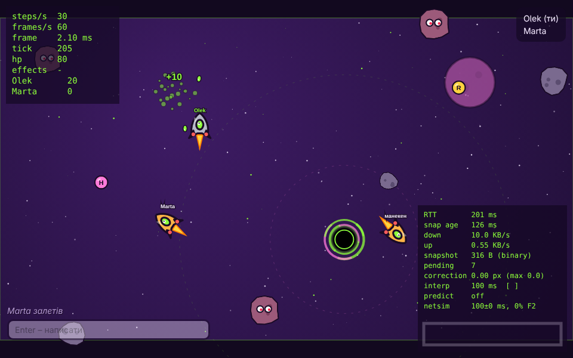

**Узгодженість.** Сервер – єдине джерело правди: клієнт не може «вирішити», що він влучив або що його не збили. Передбачений корабель після звірки збігається з серверним. При 100 ± 30 мс і 2% втрат поправки в середньому 0,005 px, максимум 0,03 px – це похибка екстраполяції позиції чорної діри. Великі поправки бувають лише тоді, коли щось сталося, чого клієнт не передбачав: зіткнення з астероїдом, удар об планету, поглинання дірою.

**Чітерство.** Клієнт надсилає лише кнопки (4 біти). Немає способу передати «я тут» чи «я влучив». Сервер перевіряє формат і обмежує частоту введень, тому прискорити свій корабель, надсилаючи введення швидше, вийде лише в межах ліміту.

**Баг детермінізму, який я зловив.** Експеримент з методички: я додав `Math.random()` у `integrate` (±10% тяги, коміт `Experiment: Math.random()…`, потім `Revert`). Поправки при тій самій мережі:

| | середня поправка | максимум |
|---|---|---|
| детермінована симуляція | 0,005 px | 0,03 px |
| з `Math.random()` у тязі | 0,38–0,42 px | 1,3 px |

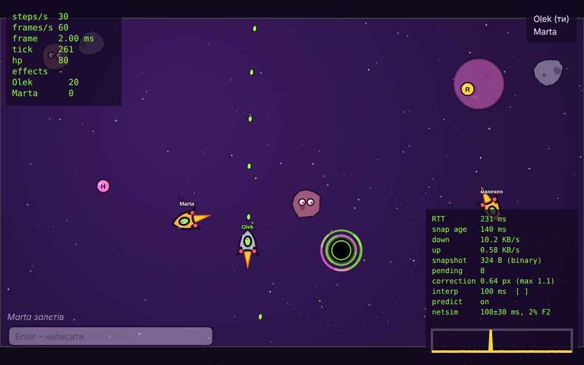

Помилка не накопичується, бо кожен знімок повертає клієнта до серверного стану. Але корабель постійно «тремтить» на кілька десятих пікселя, а з ±10% тяги на повному розгоні – помітно.

Другий баг я знайшов випадково, коли порівнював хеш однакового сценарію в Chrome і в Node: хеші різнилися вже на нульовому кроці. Різниця була в останньому біті `Math.cos`: `vx` астероїда в Node `63.36303894665002`, у Chrome `63.36303894665003`. Специфікація JavaScript не вимагає точного результату для `Math.sin/cos/atan2/hypot`, і V8 у Chrome 153 та в Node 22 рахує їх трохи по-різному. Для мультиплеєра це означає розбіжність, що накопичується. Виправив власними `sin`, `cos`, `atan2`, `hypot` у `shared/sim/fmath.js`: там лише `+ − × ÷` і `Math.sqrt`, а вони за IEEE 754 дають однаковий результат усюди. Тепер хеш сценарію на 1000 кроків однаковий у Chrome і в Node (`192f27b8`), і це закріплено тестом.

**Затримка інтерполяції.** Частка кадрів, коли для інтерполяції забракло знімків (100 ± 30 мс, 2% втрат):

| delay | 0 | 33 мс | 66 мс | 100 мс | 133 мс |
|---|---|---|---|---|---|
| кадри без знімка | 100% | 37% | 1,3% | 0% | 0% |

Я обрав 100 мс (3 тіки): це запас на розкид у 30 мс і на один загублений знімок. 66 мс майже вистачає, але при кожній втраті чужі кораблі на мить зупиняються. Плата за 100 мс – чужі кораблі показані на ~100 мс у минулому, тобто стріляти треба трохи на випередження. Компенсацію затримки на сервері (lag compensation) не робив.

## Лаба 6. TypeScript: типи для протоколу, симуляції і обох боків з'єднання

Увесь код (shared, server, client) тепер на TypeScript під `strict` + `noUncheckedIndexedAccess` + `verbatimModuleSyntax` + `erasableSyntaxOnly`. Сервер запускається без збирання: Node 22 сам вирізає типи (`node src/index.ts`), тому ніяких `enum` і parameter properties. Клієнт збирає Vite, а перевіряє `tsc`.

### Що зроблено

- `tsconfig.base.json` у корені, у кожному пакеті свій `tsconfig.json`. `npm run typecheck` у корені проганяє `tsc` у всіх трьох пакетах (≈2 с).
- `shared/protocol.ts` – єдине джерело правди: zod-схеми всіх JSON-повідомлень в обидва боки, типи виведені з них через `z.infer`. `parseClientMessage` / `parseServerMessage` повертають `Result` і ніколи не кидають. Ручний валідатор із лаби 4 (`server/src/protocol.js`) видалено.
- Бінарний кодек типізований, декодер перевіряє версію, довжину, діапазони id/tick/seq і індекси типів, на помилці кидає `CodecError`. JSON і бінарний формат – дві реалізації інтерфейсу `Codec`.
- Кожен `switch` по `type` чи `kind` закінчується `assertNever`.
- Брендовані `EntityId`, `Tick`, `Seq`; `Vector2` з `readonly x, y`; знімки `readonly`.
- `Room` – це `EventEmitter<RoomEvents>`, у клієнті й симуляції – власний `Bus<Events>`. Конфіг сервера читається з env через zod-схему з дефолтами.
- Усі `catch` отримують `unknown`, повідомлення дістає `messageOf(error)`.
- `any` – нуль, `as` – нуль (крім `as const`).
- Тест детермінізму зелений: хеш сценарію на 1000 кроків той самий `192f27b8`, тобто поведінка симуляції після перекладу не змінилася.
- `.github/workflows/ci.yml`: `npm ci`, typecheck, lint, тести і збирання на кожен push.

$${\color{red}\text{СКРІНШОТ: після push на GitHub відкрити вкладку Actions → останній запуск ci → зробити скріншот зеленого запуску}}$$
$${\color{red}\text{і зберегти як docs/img/lab06-ci.png, потім замінити цей рядок на }}$$

### Що знайшов TypeScript

1. **Невідомий бонус ламав клієнт.** Сервер кодував тип бонусу як `PICKUPS.indexOf(type)`. Для невідомого типу це `-1`, а `setUint8(-1)` записує 255. Клієнт робив `PICKUPS[255].toUpperCase()` і падав. `noUncheckedIndexedAccess` не дав написати це без перевірки, тепер декодер на такому байті кидає `CodecError`.
2. **Влучання в астероїд втрачало стрільця.** Правило `asteroid|bullet` відправляло подію `hit` з полем `ownerId`, а сервер при пакуванні читав `d.shipId`, тобто завжди 0. Коли події стали типом `WorldEvents`, поле, якого немає, просто не скомпілювалося.
3. **Відповідь `POST /api/rooms` не перевірялась.** `Lobby.create` повертав `await response.json()` як кімнату, якою б вона не була. Тепер це `fetchJson(url, RoomSchema)`.
4. **Помилка в `catch` вважалась `Error`.** У лобі й завантаженні було `error.message` і `error.name`, хоча `fetch` при скасуванні кидає `DOMException`, а `withRetry` міг отримати будь-що. Тепер усюди `unknown` і `messageOf`.
5. **Подвійний `Map.get`.** `connection.last.get("roster").players` – TypeScript не вірить, що другий `get` поверне те саме, що перший. Замінив на типізоване поле `lastRoster`.
6. **Новий бонус показав би `undefined`.** У HUD назви бонусів були об'єктом `{ shield, rapid, homing }`. Додай четвертий тип – і над кораблем з'явиться напис «undefined». Тепер це `Record<PickupType, string>`, і без назви для нового типу проєкт не збирається.
7. **`undefined <= 2` у vite-конфігу.** Мідлвар `?flaky` порівнював `flaky.get(key) <= 2`; працювало, бо перед цим був `set`, але порядок рядків ніхто не гарантує.

Номери 1, 3, 4 і 7 – це не «помилки типів» у звичному сенсі, а забуті перевірки на `undefined` і на чужі дані. Саме вони найчастіше й виявлялись.

### Три типи, які варто пояснити

**1. Брендовані id** (`shared/ids.ts`):

```ts
declare const brand: unique symbol;
export type Brand<T, B extends string> = T & { readonly [brand]: B };
export type EntityId = Brand<number, "EntityId">;
export type Tick = Brand<number, "Tick">;
```

Під час виконання це звичайне число. Але для компілятора `EntityId` і `Tick` – різні типи, і передати номер тіку туди, де чекають id корабля, не вийде. Отримати `EntityId` можна лише через перевірку `isEntityId(n)` або `entityId(n)`, яка кидає `RangeError`. До лаби 6 у `Match` поля `a` і `b` у подіях означали то id корабля, то очки, то індекс бонусу, і переплутати було дуже легко.

**2. Розмічене об'єднання знімків сутностей** (`EntitySnapSchema` у `shared/protocol.ts`):

```ts
export type EntitySnap = z.infer<typeof EntitySnapSchema>;

switch (e.kind) {
  case "ship": ...
  case "well": ...
  default: assertNever(e);
}
```

`EntitySnap` – це «або корабель, або куля, або астероїд, або бонус, або діра», і в кожного свій набір полів. Після `case "well"` TypeScript знає, що `e` – діра, і дозволяє `e.timeLeft`, а `e.hp` ні. `assertNever(e: never)` у `default` компілюється лише тоді, коли всі варіанти розібрані: коли в лабі 3 з'явились діри, усі `switch` я шукав вручну, а тепер компілятор сам показує кожен.

**3. Типізована шина подій** (`shared/bus.ts`):

```ts
export class Bus<Events extends Record<string, unknown>> {
  on<K extends keyof Events>(type: K, handler: (detail: Events[K]) => void): () => void
  emit<K extends keyof Events>(type: K, detail: Events[K]): void
}
```

`Events` – це словник «назва події → що в ній лежить». `K extends keyof Events` означає «одна з назв», а `Events[K]` – «тип даних саме цієї події». Тому `connection.events.on("pong", ({ t }) => …)` знає, що в `pong` є `t`, а `emit("hit", { size: 1 })` не скомпілюється, бо в `hit` немає `size`. У `Connection` словник подій навіть не написаний руками: `{ [K in ServerMessageType]: ServerMessageOf<K> }` будує його з zod-схеми протоколу.

### Фреймворк

Не брав. Лобі – це список кімнат, форма і кнопка, разом із чатом близько 370 рядків DOM-коду, і після переходу на `Bus` з типами подій він став зрозумілим. React чи Svelte дав би декларативний рендер списку кімнат, але додав би ще один рантайм у бандл (зараз 163 кБ, 52 кБ gzip, більшість – zod) і ще один шар збирання, а гра однаково малюється на canvas у власному циклі. Якщо в лабі 8 інтерфейс розростеться (налаштування, таблиця рекордів), повернуся до цього питання.

## Лаба 7. Тести, профілювання, боти і навантаження

### Тести

- `npm test` у корені – Vitest у всіх трьох пакетах (`vitest.config.ts` з `projects`), зараз 137 тестів у 23 файлах. `npm run coverage` – те саме з покриттям; для `shared/` стоїть поріг 85 % (зараз 98 % рядків, 89 % гілок).
- Юніт: `Vector2`, `integrate`, корабель (шкода, щит, респаун, кулдаун пострілу), колізії (дотик, перетин, промах, «чи пролітає куля крізь астероїд»), детермінізм `World` (два світи з однаковим seed крок у крок), шина, id, протокол, `replayInputs` (звірка як чиста функція), `Predictor`, буфер інтерполяції, token bucket, `withRetry`, конфіг сервера.
- Фейкові таймери: цикл з акумулятором (60 кроків за симульовану секунду, `alpha ∈ [0, 1)`, обрізання довгої паузи до 15 кроків, `stop`) і heartbeat (тихий клієнт відпадає на третьому тіку).
- Інтеграційні: справжній сервер на випадковому порту – join, roster, бінарні знімки, `ack` після вводу, сміття → `4000`, флуд → `4002`, клієнт без `pong` відключається, чат, бот-ендпоінт.
- fast-check, 10 властивостей: round-trip кодека з допуском float32/кута, довжина кадру точно за `docs/protocol.md`, випадкові байти і зіпсований справжній кадр → тільки `CodecError`, вводи round-trip, `wrap` завжди в `[0, size)`, кораблі не вилітають з арени за 1000 випадкових кроків (з чорною дірою на арені), `parseClientMessage` приймає кожне згенероване валідне повідомлення і відкидає кожну мутацію, spatial hash дає ті самі пари в тому самому порядку, що й перебір.
- Playwright (`npm run e2e`): два контексти браузера в одній кімнаті – обидва бачать одне одного в roster, другий бачить рух першого корабля менш ніж за 500 мс, повідомлення в чаті доходить. Локально хром беру системний (`CHROME_PATH=/usr/bin/google-chrome npm run e2e`), у CI його ставить `playwright install`.
- CI: `typecheck → lint → coverage → build`, потім окремий job з e2e. Biome з `noFloatingPromises` і `noMisusedPromises`; він знайшов один промис – `boot()` у `main.ts`, помилка завантаження просто губилась. Тепер її видно на екрані.

**Що знайшли тести.** Властивість «`wrap` завжди в `[0, size)`» упала на першому ж запуску з контрприкладом `-5e-324`: `-5e-324 + 1600` округлюється до рівно `1600`, і координата виходила за арену. Крім того, `wrap` обробляв лише один «оберт» (`wrap(-2000, 1600)` давав `-400`). У грі на таке не натрапиш, бо швидкості малі, але для майбутніх швидких об'єктів це була б тиха помилка. Виправив так, щоб для старого діапазону результат був побітово той самий, – golden-хеш детермінізму не змінився.

$${\color{red}\text{СКРІНШОТ: після push відкрити GitHub → Actions → останній запуск ci, зробити скріншот з двома зеленими jobs (check, e2e)}}$$
$${\color{red}\text{і зберегти як docs/img/lab07-ci.png; потім замінити ці два рядки на }}$$

### Профілювання клієнта

Сесія 30 с: я в кімнаті + 8 ботів, тримаю газ, поворот і постріл (тобто постійно вибухи і кулі), headless Chrome на тій самій віртуалці з 2 vCPU. Час кадру – з кільцевого буфера `Samples` у циклі (без алокацій), GC – з трейсу (`MinorGC`/`MajorGC`), алокації – sampling heap profiler з урахуванням уже зібраних об'єктів, self time – CPU-профайлер. Запуск: `CHROME_PATH=/usr/bin/google-chrome node scripts/profile-client.mjs after 30 8` при запущених `npm run dev`; сирі дані – у `docs/perf/client-before.json` і `client-after.json`, профілі – `docs/perf/*.cpuprofile`.

| 30 с, 8 ботів                  | до                                  | після                                     |
| ------------------------------ | ----------------------------------- | ----------------------------------------- |
| кадр p50 / p95 / p99 / max, мс | 0.7 / 1.5 / 2.1 / 7.7               | 0.3 / 0.8 / 1.2 / 6.6                     |
| `render` p50 / p95, мс         | 0.8 / 2.2                           | 0.3 / 0.6                                 |
| `simulate` p95, мс             | 1.4                                 | 0.2                                       |
| `decode`, `reconcile` p99, мс  | 0.3 / 0.1                           | 0.2 / 0.2                                 |
| виділено пам'яті за 30 с       | 58.9 МБ                             | 27.1 МБ                                   |
| Minor GC                       | 21 шт, 26.6 мс                      | 18 шт, 23.8 мс                            |
| Major GC                       | 7 шт, 24.6 мс                       | 6 шт, 20.5 мс                             |
| топ алокацій                   | `Explosion.update` 11.5 МБ, `render` 6.0 МБ, `blend` 5.8 МБ | `render` 5.0 МБ, `SnapshotBuffer.push` 2.3 МБ, `sample` 2.1 МБ |
| топ self time                  | `fillText` 214 мс, `fill` 162 мс, `drawImage` 118 мс, `drawBackground` 111 мс | `drawImage` 98 мс, GC 86 мс, `save` 47 мс |

$${\color{red}\text{СКРІНШОТ 1: Chrome → DevTools → Performance → кнопка Load profile → docs/perf/client-before.cpuprofile;}}$$
$${\color{red}\text{збільшити ділянку на 2-3 кадри, щоб було видно render → drawBackground і Explosion.update; зберегти як docs/img/lab07-flame-before.png}}$$
$${\color{red}\text{СКРІНШОТ 2: те саме для docs/perf/client-after.cpuprofile → docs/img/lab07-flame-after.png; потім замінити ці рядки на два зображення}}$$

Що зробив, у порядку виміряного ефекту:

1. **Частинки вибуху.** `p.pos = p.pos.add(p.vel.scale(dt))` створював два `Vector2` на частинку за кадр, а частинок у вибуху 18–45. Тепер частинка – `{ x, y, vx, vy, r }`, які змінюються на місці, а самі вибухи беруться з `Pool` (`shared/pool.ts`) і повертаються туди. Порядок викликів `rng` не змінився, тому серверний хеш той самий.
2. **Інтерполяція.** `blend` щокадру створював `Map` і новий об'єкт на кожну сутність, `serverTick` робив `Math.min(...offsets)` по масиву з 90 чисел. Тепер індекс `id → сутність` будується один раз при отриманні знімка, змішані сутності пишуться в ті самі об'єкти, мінімальний зсув рахується при `push`. Буфер зменшив з 3 с до 1 с – більше 500 мс затримки інтерполяції все одно не буває.
3. **Фон і текст.** Градієнт, 220 зірок і планета малювались кожен кадр – тепер один раз в offscreen canvas і далі `drawImage`. HUD і netgraph перебудовуються 4 рази на секунду в `TextPanel`, а не 60: так зник `fillText` з топу self time.
4. **Кулі передбачення** – теж з пулу, видалення з масиву на місці (`removeWhere`) замість `filter`, без замикань і масивів, що створюються щокадру (`DRAW_ORDER` винесений з `render`, предикати – константи модуля).

**Major GC.** До нуля не дійшов, і ось чому. Усі 6 збірок у трейсі – це `finalize incremental marking via task` при купі 4–7 МБ, після збірки лишається 3.7–3.9 МБ. Їх запускає ріст старого покоління: знімок живе в буфері до секунди, а scavenge відбувається приблизно раз на 1.5 с, тож частина з ~1800 об'єктів знімків за секунду встигає пережити збірку і переїхати в old space. Маркування йде інкрементально у фоні, а фіналізація займає 3.4 мс в окремій задачі між кадрами: найдовший кадр за сесію 6.6 мс, бюджет 16.7 мс. Щоб прибрати і це, треба декодувати знімки не в об'єкти, а в заздалегідь виділені `Float32Array` (structure of arrays) – це вже stretch-завдання. p99 кадру 1.2 мс < 16.7 мс виконується з великим запасом.

### Профілювання сервера

`node --cpu-prof`, одна кімната на 64 клієнти навантажувального скрипта, 20 с, ~185 сутностей. Профілі – `docs/perf/server-brute.cpuprofile` і `server-grid.cpuprofile`.

| 64 гравці в кімнаті      | перебір O(n²)   | spatial hash   |
| ------------------------ | --------------- | -------------- |
| self time колізій за 20 с | 52 мс           | 18 мс          |
| тік p50 / p99 (без профайлера, 2 прогони) | 1.22 / 3.0, 1.28 / 2.4 мс | 1.22 / 3.3, 1.22 / 2.9 мс |
| найдорожче в профілі     | `writev` 23 %, GC 6 %, `bruteForce` 2.8 % | `writev` 22 %, GC 6.5 % |

Колізії були найдорожчою JS-функцією сервера, тому зробив spatial hash (`shared/sim/collision.ts`): сітка 128 px, пара перевіряється лише в клітинці, де починається перетин їхніх рамок, тому `Set` для дублікатів не потрібен, а знайдені пари сортуються, щоб порядок був той самий, що в переборі (від цього залежить детермінізм). Для сцен менше 100 сутностей лишився перебір – на 50 сутностях сітка нічого не дає. Мікробенчмарк (`server/scripts/bench-collisions.ts`): 150 сутностей – у 2 рази швидше, 600 – у 3.5, 1200 – у 3.8.

Чесний висновок: на p99 тіку це не вплинуло. Головна вартість тіку – не симуляція, а розсилка: 64 знімки по ~4 КБ 30 разів на секунду, тобто `writev` у ядро.

### Боти

`server/src/bot.ts`: `Bot implements PlayerInput` – кожен тік бот дивиться на світ, вирішує, що натиснути, і віддає `InputRecord { seq, buttons }` у той самий `Match.receiveInputs`, що й людина. Логіка: якщо поруч чорна діра, планета чи астероїд – розвертається від них і тікає; інакше цілиться в найближчий корабель (до 800 px) або астероїд, стріляє, коли кут менше 0.18 рад. Відстані враховують загортання арени. `POST /api/rooms/:id/bots` з `{ "count": 1..16 }` додає ботів, вони з'являються в roster і зникають, коли кімнату покидає остання людина. Ліміт гравців у кімнаті підняв до 16.

### Web Worker: декодування знімків (не взяв)

`?worker`: бінарний знімок передається у воркер як transferable `ArrayBuffer`, воркер декодує і повертає об'єкт. 20 с, 8 ботів:

|                                   | у головному потоці | у воркері            |
| --------------------------------- | ------------------ | -------------------- |
| час у головному потоці на знімок, p99 | 0.1 мс (декодування) | 0.2 мс (structured clone назад) |
| затримка від отримання до готового знімка, p50 / p99 / max | 0 / 0.1 / 0.4 мс | 0.3 / 6.8 / 83 мс |
| кадр p99                          | 1.7 мс             | 1.7 мс               |

Рішення – ні. Декодування 600 байт займає соту частку мілісекунди, а повернення результату через structured clone коштує головному потоку стільки ж або більше, плюс до 7 мс затримки на p99. Воркер виграє, коли робота важка, а результат малий; тут навпаки. Код лишив за прапорцем як задокументований експеримент.

### Навантаження і ємність

`server/scripts/loadtest.ts N... секунд розмір_кімнати`: N клієнтів на `ws` по 8 у кімнаті, кожен 30 разів на секунду шле випадкові кнопки. Після 3 с розігріву 12 с міряються тік p99, реальний інтервал між тіками, event loop utilization і CPU з `/api/stats`, RSS і вихідний трафік. Генератор навантаження працює на тій самій машині з 2 vCPU.


| клієнтів | кімнат | тік p99, мс | інтервал тіку, мс | ELU  | RSS, МБ | вихідний трафік, КБ/с |
| -------- | ------ | ----------- | ----------------- | ---- | ------- | --------------------- |
| 8        | 1      | 2.1         | 33.3              | 0.03 | 114     | 224                   |
| 32       | 4      | 0.8         | 33.3              | 0.06 | 118     | 927                   |
| 64       | 8      | 1.1         | 33.3              | 0.09 | 135     | 1 876                 |
| 128      | 16     | 1.0         | 33.3              | 0.17 | 144     | 3 720                 |
| 256      | 32     | 1.0         | 33.3              | 0.32 | 159     | 7 371                 |
| 512      | 64     | 1.3         | 33.3              | 0.55 | 164     | 14 742                |
| 768      | 96     | 2.3         | 33.4              | 0.81 | 202     | 22 025                |
| 1024     | 128    | 5.2         | 41.5              | 1.00 | 253     | 26 678                |
| 1280     | 160    | 6.4         | 59.8              | 1.00 | 296     | 28 175                |

**Ємність – 768 клієнтів** на цій машині. Тік окремої кімнати ніколи не наближається до 33 мс (p99 до 6 мс), але всі кімнати живуть в одному event loop: на 1024 він зайнятий 100 % часу, таймери спізнюються, і реальний інтервал між тіками стає 41 мс, на 1280 – 60 мс (гра фактично йде на 17 Гц), а трафік перестає рости. Тобто вузьке місце – CPU одного потоку, і більша його частина йде на відправку знімків у сокети, а не на симуляцію. RSS при цьому скромний, GC не помітний. Наступний крок – кімнати в `worker_threads` або кілька процесів.

## Лаба 8. Продакшн: процес, захист, контейнер, деплой

### Процес

- **Логи** – `pino`, JSON у stdout, рівень з `LOG_LEVEL`. Кожне з'єднання має свій дочірній логер з `ip`, після входу – з `roomId` і `playerId`, тому всі події одного гравця знаходяться одним фільтром. У базових полях – `version` і `commit`. Поля `token`, `password` і cookie вирізаються (`redact`), хоча зараз їх і так ніде немає.
- **`/health`** – живий процес: `{ status, version, commit, uptime, rooms, players }`. **`/ready`** – 200, поки сервер приймає гравців, і 503 з моменту `SIGTERM`; `/ready` перевіряє балансувальник Fly, `/health` – `HEALTHCHECK` у Docker.
- **Версія** – `APP_VERSION` (тег) і `GIT_SHA` передаються як build-args у Docker, на клієнт потрапляють через `define` у Vite і видні в HUD рядком `build`.
- **`/metrics`** – `prom-client`: `gloop_players`, `gloop_rooms`, `gloop_connections`, `gloop_messages_in_total{format}`, `gloop_messages_out_total`, `gloop_bytes_in_total` / `_out_total` (з них Prometheus рахує msg/s і bytes/s через `rate()`), гістограма `gloop_tick_seconds` і `gloop_tick_p99_ms`, `gloop_event_loop_utilization`, `gloop_rejections_total{reason}` з причинами `bad_message`, `rate_limited`, `join_timeout`, `slow_client`, `room_full`, `no_room`, `origin`, `ip_limit`, `heartbeat`, `shutting_down`, плюс стандартні метрики процесу (`gloop_process_resident_memory_bytes`, GC, хендли).
- **Невідомі помилки** – `uncaughtException` і `unhandledRejection` пишуться як `fatal` зі стеком, і процес завершується з кодом 1: краще перезапуск від платформи, ніж сервер у невідомому стані.
- **Конфіг** – zod-схема (`server/src/config.ts`), всі змінні з дефолтами в `server/.env.example`:

| Змінна                   | Типово        | Що робить |
| ------------------------ | ------------- | --------- |
| `ALLOWED_ORIGINS`        | порожньо      | список `https://...` через кому; порожньо – тільки той самий хост |
| `MAX_CONNECTIONS_PER_IP` | 8             | одночасних WebSocket з однієї адреси |
| `TRUST_PROXY`            | 0             | брати IP з `X-Forwarded-For` (вмикати лише за проксі) |
| `MAX_ROOMS` / `MAX_PLAYERS_PER_ROOM` | 50 / 16 | ліміти кімнат |
| `MESSAGES_PER_SECOND`    | 20            | token bucket на керуючі повідомлення |
| `HEARTBEAT_MS`           | 15000         | ping; 15 с тримає з'єднання живим крізь idle timeout проксі (60 с у Fly) |
| `SHUTDOWN_TIMEOUT_MS`    | 8000          | після цього вихід примусово |
| `LOG_LEVEL`              | info          | рівень pino |

**Graceful shutdown.** `SIGTERM` → `/ready` стає 503, `server.close()` перестає приймати нові з'єднання, усім гравцям іде `shutdown` і close `1001`, сервер чекає закриття сокетів (не довше половини `SHUTDOWN_TIMEOUT_MS`), дописує логи матчів і виходить з кодом 0. З гравцями в кімнаті від сигналу до `bye` в лозі пройшло 9 мс, процес завершився за 1.3 с. Таймер на 8 с гарантує вихід, навіть якщо щось зависне, – Docker і Fly дають 10 с до `SIGKILL`. Тест `server/test/ops.test.ts` перевіряє `shutdown` + `1001` і те, що нові з'єднання після сигналу відхиляються. У контейнері: `docker compose stop` з чотирма гравцями в кімнаті зайняв 268 мс, усі чотири вийшли з кодом 1001, у лозі «bye» через 12 мс після сигналу, контейнер – `Exited (0)`.

### Захист і chaos-тести

- **Origin і ліміт на IP** перевіряються в `upgrade` до створення WebSocket (`server/src/gate.ts`): чужий `Origin` – HTTP 403, перевищення ліміту – 429, обидва рахуються в `gloop_rejections_total`. Клієнти без `Origin` (не браузер) пропускаються: підробити заголовок вони однаково можуть, а захищає ця перевірка від сторонньої сторінки, яка відкриває сокет від імені гравця в його браузері.
- Ліміти з лаби 4 (розмір повідомлення, token bucket, join timeout, повільний клієнт, heartbeat) працюють під навантаженням: прогони з лаби 7 на 1280 клієнтах і флуд нижче.
- **Клієнт помер посеред гри** – після `ws.terminate()` у клієнта сервер прибирає корабель і розсилає roster; без закриття з'єднання (обірвана мережа) це робить heartbeat через 2–3 інтервали (тест `heartbeat.test.ts` з фейковими таймерами і інтеграційний у `ws.test.ts`).
- **Сервер помер посеред гри.** Клієнт показує банер і перепідключається з backoff і jitter, а коли сервер повертається, закриває нове з'єднання і показує лобі з поясненням. Плановий перезапуск (`shutdown` від сервера) і падіння (`SIGKILL`, код 1006) пояснюються по-різному:

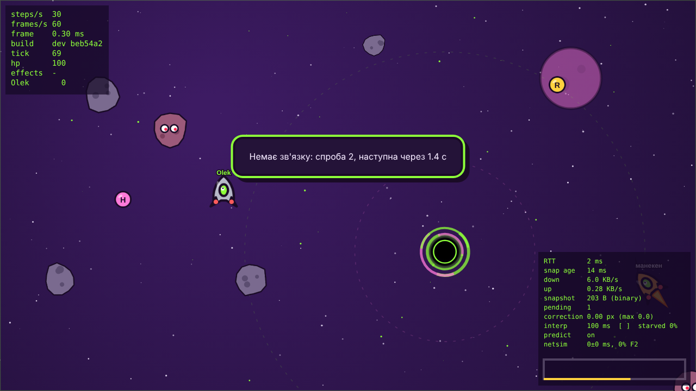
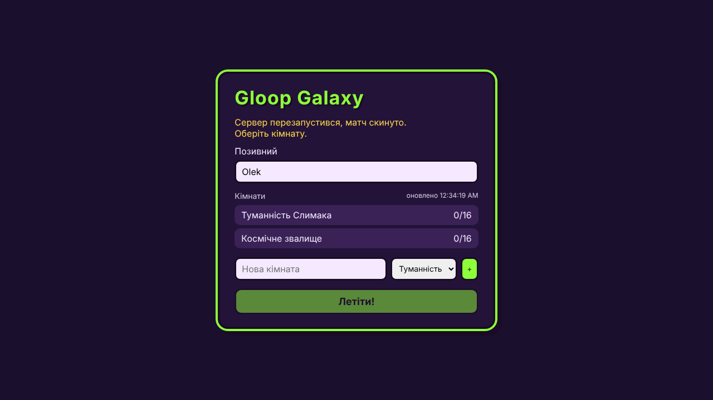

  Від `SIGKILL` до лобі пройшло 5.0 с (сервер піднімався 4 с), від `SIGTERM` – 4.7 с.

- **Сміття 1000 разів на секунду** – `server/scripts/chaos-flood.ts`: у кімнаті A 8 звичайних гравців, з тієї ж машини інший клієнт шле випадкові байти кожну мілісекунду і після кожного закриття одразу перепідключається. Сервер закриває кожне таке з'єднання з кодом 4000 на першому ж кадрі, тож замість 1000 кадрів/с вийшло 590 нових з'єднань/с, кожне закрите, записане в лог і пораховане:

| кімната A, 10 с      | тік p50 | тік p99 | інтервал тіку | ELU   |
| -------------------- | ------- | ------- | ------------- | ----- |
| до флуду             | 0.42 мс | 1.33 мс | 33.34 мс      | 0.033 |
| під час флуду        | 0.31 мс | 0.72 мс | 33.32 мс      | 0.075 |

  `gloop_rejections_total{reason="bad_message"}` виріс рівно на 590 за 10 с, усі 590 закриттів мали код 4000. Тік сусідньої кімнати не погіршився (p99 навіть нижчий – різниця в межах шуму), а флуд коштував серверу 4 % event loop.

### Контейнер

`Dockerfile` з трьох стадій: `build` (повний `npm ci` і збирання клієнта), `deps` (`npm ci --omit=dev`), `runtime` на `node:22-alpine` – тільки продакшн-залежності (`ws`, `zod`, `pino`, `prom-client`), `shared/`, `server/src` і зібраний клієнт, без тестів і скриптів (`.dockerignore`). Сервер запускається напряму з TypeScript (`node src/index.ts`, Node сам вирізає типи), тож окремої компіляції немає. Користувач `node`, exec-форма `CMD`, `STOPSIGNAL SIGTERM`, `HEALTHCHECK` через `fetch` до `/health` (у образі немає `curl`). Шари застосунку над базовим образом – 17.4 МБ (`docker history`: `node_modules` 16.4 МБ, зібраний клієнт 0.5 МБ, код сервера і `shared` 0.3 МБ).

`compose.yaml` – локальний запуск як у продакшні і профіль `staging` для навантажувального тесту:

```bash
docker compose up --build -d          # гра на http://localhost:8080
docker compose ps                     # STATUS: Up (healthy)
docker compose logs -f gloop          # JSON-логи pino
docker compose stop gloop             # graceful shutdown, Exited (0)

docker compose --profile staging up -d staging
TARGET=http://localhost:8081 node server/scripts/loadtest.ts 64,256 12
```

Перевірка образу через compose:

| Що перевіряв | Результат |
| ------------ | --------- |
| стан після старту | `Up (healthy)` через ~15 с, `HEALTHCHECK` проходить |
| користувач у контейнері | `uid=1000(node)` |
| `/health` | `{"status":"ok","version":"v1.0.0","commit":"7478c27",...}` – версія і коміт з build-args |
| гра в браузері на :8080 | лобі, кімната з 4 ботами, у HUD рядок `build v1.0.0 7478c27` |
| 12 з'єднань з однієї IP при ліміті 8 | 8 відкрито, 4 отримали 429, `gloop_rejections_total{reason="ip_limit"} 4` |
| чужий `Origin` | 403, `reason="origin"` 1 |
| `docker compose stop` з 4 гравцями | 268 мс, усім 1001, `Exited (0)` |
| staging, 64 і 256 клієнтів | тік p99 0.9 і 1.1 мс, інтервал 33.34 мс, ELU 0.14 і 0.39, RSS 133 і 143 МБ, 0 відмов |

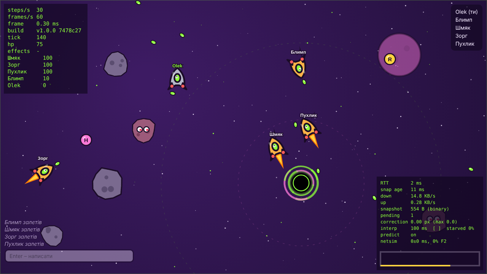

Образ для цієї перевірки я збирав з `--build-arg NODE_IMAGE=...` на локально зібраній базі з тим самим Node 22.23 (Docker Hub з моєї машини був недоступний), тому загальний розмір у мене не показовий: база на glibc важить 339 МБ. На `node:22-alpine` (близько 160 МБ) образ має вийти приблизно 178 МБ.

$${\color{red}\text{ЗАПИСАТИ РОЗМІР ОБРАЗУ: docker compose build, потім docker images gloop-galaxy — вписати сюди число (має бути менше 200 МБ).}}$$
$${\color{red}\text{У GitHub Actions розмір також пишеться в summary кроку Image size}}$$

### Деплой

- `.github/workflows/ci.yml` – як і раніше, на кожен push і PR: typecheck → lint → тести з покриттям → build → e2e.
- `.github/workflows/deploy.yml` – на теги `v*`: спочатку той самий CI (через `workflow_call`), потім збирання образу з `GIT_SHA` і `APP_VERSION` = тег, push у GHCR, `flyctl deploy --image ...` і перевірка, що `https://<хост>/health` повертає саме цей тег.
- `fly.toml` – регіон `waw` (Варшава, найближчий до Києва), `force_https`, тож клієнт сам обирає `wss://` (`socketUrl()` дивиться на `location.protocol`), `TRUST_PROXY=1` для справжніх IP, `ALLOWED_ORIGINS` з публічною адресою, перевірка `/ready`, `kill_timeout = 10`, `auto_stop_machines = "off"`, бо машина, що засинає, рве матчі.

$${\color{red}\text{ЗРОБИТИ ОДИН РАЗ: 1) зареєструватися на fly.io, встановити flyctl, виконати fly auth login; 2) у fly.toml змінити app і ALLOWED\_ORIGINS на свою назву;}}$$
$${\color{red}\text{3) fly apps create НАЗВА; 4) fly tokens create deploy і додати токен у GitHub: репозиторій → Settings → Secrets and variables → Actions → секрет FLY\_API\_TOKEN;}}$$
$${\color{red}\text{5) там же у Variables додати PUBLIC\_HOST = НАЗВА.fly.dev; 6) після першого push образу зробити пакет у GHCR публічним (Packages → Package settings);}}$$
$${\color{red}\text{7) git push --tags. Потім відкрити https://НАЗВА.fly.dev/health і перевірити version = v1.0.0; скріншот → docs/img/lab08-health.png}}$$

### PWA

`manifest.webmanifest` з іконками 192 і 512 (maskable), `display: fullscreen`, альбомна орієнтація, і service worker (`public/sw.js`): статика з `/assets/` – cache-first, сторінка – network-first з запасною копією в кеші, `/api`, `/ws` і `/health` не кешуються ніколи. Chrome (`Page.getInstallabilityErrors`) не знаходить жодної перешкоди для встановлення. Реєструється лише в продакшн-збірці, щоб не заважати Vite в розробці.

$${\color{red}\text{ПЕРЕВІРИТИ НА ТЕЛЕФОНІ: відкрити публічну адресу в Chrome на Android → меню → «Встановити застосунок» (або Safari → Поділитися → На початковий екран);}}$$
$${\color{red}\text{скріншот іконки на головному екрані і відкритої гри → docs/img/lab08-pwa.png}}$$

### Запуск з людьми

$${\color{red}\text{ЗРОБИТИ: попросити двох людей з інших мереж (не твій Wi-Fi) зайти в одну кімнату одночасно з тобою і зіграти 2-3 хвилини;}}$$
$${\color{red}\text{записати екран (OBS, Win+G або Cmd+Shift+5), з відео зробити GIF → docs/img/lab08-strangers.gif;}}$$
$${\color{red}\text{попросити кожного в кінці гри зробити скріншот netgraph (правий нижній кут) і заповнити таблицю нижче без імен}}$$

| Гравець   | Місто / мережа | RTT, мс | down, КБ/с | correction max, px | starved, % |
| --------- | -------------- | ------- | ---------- | ------------------ | ---------- |
| я         | $${\color{red}\text{?}}$$ | $${\color{red}\text{?}}$$ | $${\color{red}\text{?}}$$ | $${\color{red}\text{?}}$$ | $${\color{red}\text{?}}$$ |
| гравець A | $${\color{red}\text{?}}$$ | $${\color{red}\text{?}}$$ | $${\color{red}\text{?}}$$ | $${\color{red}\text{?}}$$ | $${\color{red}\text{?}}$$ |
| гравець B | $${\color{red}\text{?}}$$ | $${\color{red}\text{?}}$$ | $${\color{red}\text{?}}$$ | $${\color{red}\text{?}}$$ | $${\color{red}\text{?}}$$ |

$${\color{red}\text{МОНІТОРИНГ: на uptimerobot.com (безкоштовно) додати HTTP-монітор на https://НАЗВА.fly.dev/health з інтервалом 5 хв; скріншот → docs/img/lab08-uptime.png}}$$
$${\color{red}\text{МЕТРИКИ: під час гри відкрити https://НАЗВА.fly.dev/metrics, скріншот рядків gloop\_ → docs/img/lab08-metrics.png}}$$
